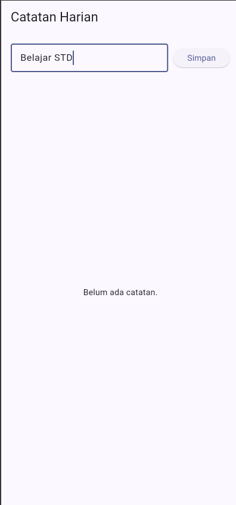
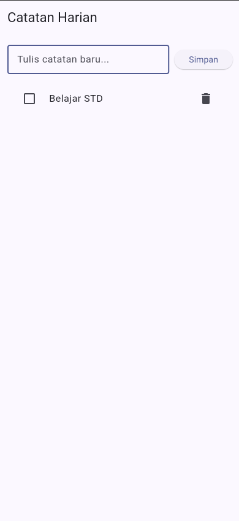
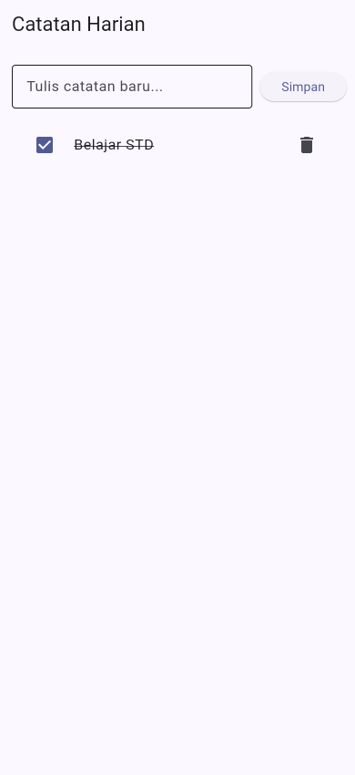

**Nama:** MUHAMMAD AKMAL MURSALIM  
**NIM:** 103012500102  

## Demo Aplikasi

## Cara Menjalankan

Pastikan **Flutter SDK** sudah terpasang di perangkat, lalu jalankan perintah berikut di terminal:

flutter create .
flutter pub get
flutter run

## Deklarasi Penggunaan AI
- Apakah menggunakan AI? Ya 
- Tool AI yang digunakan: Antigravity IDE
- Estimasi persentase kontribusi AI: 35%
- Bagian kode/fitur yang dibantu AI: 
  - Membantu dalam pembuatan UI sederhana
  - Memperbaiki error pada kode
  - Membantu mem-build .apk tanpa Android Studio
- Pernyataan: 
  "Saya menyatakan bahwa saya memahami alur dan fungsi dari seluruh kode yang ada dalam repositori ini"
